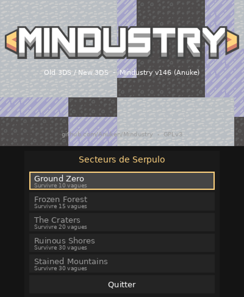
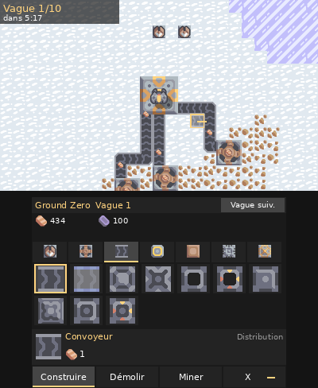
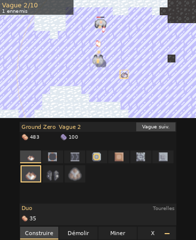

# Mindustry 3DS

[Français](README.md) | English

A native port of **Mindustry v146** (Anuke, GPLv3) for **Nintendo 3DS**, designed for the **Old 3DS XL** (268 MHz ARM11, 64 MB application mode), also compatible with New 3DS.

This repository is the successor to Forge3DS 1.4.6. Forge3DS was a Mindustry-inspired reimplementation with manually copied values and software rendering. Mindustry 3DS is built **from the original open-source project**: [Anuken/Mindustry](https://github.com/Anuken/Mindustry) is included as a submodule pinned to tag `v146`, and game content is extracted from it at build time.

| Menu | Ground Zero base | Combat |
|---|---|---|
|  |  |  |

*These screenshots were generated on a PC by `tests/screenshot.cpp`, using the game's actual drawing commands and generated sprites. Only the font differs from the console version. Gameplay testing on the console has been performed on real Old 3DS XL hardware, without an emulator. Host-side automated tests and visual checks are separate.*

**New in 0.3:** water, mechanical pump, conduits, tank and steam generator following v146 rules; save format 2, with support for loading 0.2 saves ([docs/LIQUIDES_0.3.md](docs/LIQUIDES_0.3.md)).

**New in 0.2:** visual artifact fixes (mirrored sprites offset by citro2d, downscaling halos, pixel alignment and atlas borders), official composite icons, conveyors faithful to `Conveyor`/`Autotiler` (connections, animation and corner previews), node and bridge configuration, machine status and power balance, solar panels, pulverizer and mixers, and FPS measurement in the pause menu. Details: [docs/AMELIORATIONS_0.2.md](docs/AMELIORATIONS_0.2.md); Forge3DS inventory: [docs/FORGE3DS_INVENTAIRE.md](docs/FORGE3DS_INVENTAIRE.md).

## What comes from the original Mindustry?

| Component | Upstream source | Processing |
|---|---|---|
| Block, item and unit values | `content/Blocks.java`, `Items.java`, `UnitTypes.java` and class defaults (`Drill.java`, `Turret.java`, etc.) | `tools/javacontent.py` parses Java initializers, constructors and inheritance to generate C++ tables |
| Sector maps | `core/assets/maps/*.msav` (Ground Zero, Frozen Forest, The Craters, Ruinous Shores, Stained Mountains) | `tools/msav.py` reads the save format (a port of `SaveVersion.java`): floors, ores, walls, buildings, spawn points, rules and waves |
| Waves | Map JSON rules, `game/Waves.java` | Faithful port of `SpawnGroup.getSpawned()` |
| Sectors | `SectorPresets.java` | Capture wave and initial countdown multiplier |
| Sprites | `core/assets-raw/sprites` | Downscaled to 16 px per tile (half the original size), outlined like Mindustry's packer and packed into a `tex3ds` atlas |
| Text | `core/assets/bundles/bundle_*.properties` | Block, item and sector names in French, English, German, Spanish, Italian and Japanese, based on the console language |

Game logic is a C++ port of the Java classes' `updateTile()`, `acceptItem()` and `handleItem()` methods. Examples:

- **Conveyor:** `Conveyor.ConveyorBuild.updateTile` (spacing 0.4, speed 0.03, corner merging via `Autotiler`). Measured throughput: 4.2 items/s, matching Mindustry's displayed value.
- **Drill:** `Drill.getDrillTime = drillTime + 50 × hardness`, warmup 0.015, dominant ore selection (`countOre`). A mechanical drill over four copper tiles produces 41 items in 120 seconds.
- **Router, junction, sorter, overflow gate and bridge:** `proximity` rotation, buffers and `instantTransfer`.
- **Factories** (`GenericCrafter`), **combustion generator** (`ConsumeItemFlammable`) and **power network** (`PowerGraph`, batteries and automatic node connections).
- **Turrets** (`ItemTurret`): item ammunition, `ammoMultiplier`, `limitRange()`, firing rate, firing cone, flak and artillery.
- **Construction:** `ConstructBlock.construct` (accumulators, gradual resource deduction from the core) and deconstruction with a 50% refund.
- **Units:** Dagger, Flare, Alpha and Beta. Each unit's two weapons fire alternately (`Weapon.alternate`). Ground units follow a flow field (`Pathfinder.costGround`), while flying units use `FlyingAI`. Alpha mines according to `MinerComp` and transfers items directly to the core.

## Why not run the Java game?

There is no JVM available for this port on the 3DS, and the desktop game far exceeds the 64 MB available in Old 3DS mode. Its texture atlas spans multiple 4096 × 4096 pages, whereas the PICA200 GPU is limited to 1024 × 1024 textures. This port therefore retains Mindustry's data and rules while replacing the Arc/Java engine with native C++:

- **Simulation** runs on the ARM11 application core, with a capped delta like Arc's `Time.delta`.
- **GPU rendering** uses citro2d (PICA200) instead of Forge3DS's software renderer.
- A single 1024 × 1024 RGBA8 atlas contains the 230 sprites used.

## What has not been ported yet?

Liquids other than water, liquid junctions and bridges, unit factories and reconstructors, the research tree and inter-sector launches, logic processors (Ground Zero's processors are ignored and the wave timer starts immediately), weather, fog, status effects, drill water boosts and Erekir.

Unported blocks found on maps are removed at load time (listed in `build/gen/assets_report.json`). Saves use a port-specific format and are not compatible with Mindustry's `.msav` files.

## Controls

| Button | Action |
|---|---|
| Circle Pad | Control Alpha (camera follows) |
| D-Pad | Move the building cursor, with key repeat |
| A | Place a block; hold A and move the cursor to draw a conveyor line oriented along the path, with corner previews |
| A on a node, bridge or sorter | Configure it: A on a target connects/disconnects it; A on the node itself enables automatic connections or disconnects all; L/R selects the sorted item; B exits configuration |
| B | Demolish under the cursor |
| X | Rotate the block |
| Y | Mine ore under the cursor (press again to stop) |
| L / R | Previous / next block in the category |
| SELECT | Next category |
| START | Pause: resume, save and quit, or quit; also displays measured FPS and CPU time |
| Touchscreen | Categories, blocks, Build / Demolish / Mine modes, Next Wave; hovering over a building displays its information (status, reason and network) |

Sectors unlock in campaign order: survive until a sector's capture wave to unlock the next one. The game autosaves every two minutes and on exit to `SD:/3ds/mindustry-3ds/`.

## Installation

- **Homebrew Launcher:** copy `mindustry-3ds.3dsx` to `SD:/3ds/`. Game data is included in the file.
- **CIA:** install `mindustry-3ds.cia` using FBI. Title ID `000400000F4D5300`, Old 3DS 64 MB mode, 256 KiB stack.

Binaries are built by GitHub Actions: **Actions → Build → mindustry-3ds artifact**.

## Building

```sh
git clone --recurse-submodules --shallow-submodules https://github.com/wabyu/mindustry-3ds-.git
cd mindustry-3ds-
# devkitPro (3ds-dev group) + Python 3 with Pillow
make            # generates build/gen and romfs/ from upstream/Mindustry, then mindustry-3ds.3dsx
make test       # PC simulation tests (AddressSanitizer + UBSan)
make scenes     # visual test scenes using the real atlas (build/scenes/*.png)
bash tools/install_cia_tools.sh && source .cia-tools/env.sh && make cia
```

With Docker: `docker run --rm -v $PWD:/src -w /src devkitpro/devkitarm make` (install `python3-pil` in the container first, as shown in `.github/workflows/build.yml`).

### Project structure

```
upstream/Mindustry   Anuken/Mindustry submodule @ v146 (single source of game data)
tools/               javacontent.py, msav.py, build_assets.py, render_shots.py, CIA
source/              C++ engine: world/sim/units (simulation), app (UI), main_3ds (citro2d)
tests/               host_test.cpp (rules), screenshot.cpp + gfx_host.cpp (screenshots)
cia/                 RSF, banner, sound
```

## Validation status

- 110 host-side checks pass, including pumping, transfer, saturation, conservation, steam and loading 0.2 saves, as well as throughput, recipes, power (connections, 10-link limit, states, batteries), conveyors (four directions, 28 connection cases, merging, junctions, titanium, congestion, rotation and lossless upgrades), combat, construction, five official maps and saves.
- Visual test scenes: zero sprites at 0°/90° placed between pixels, zero texels sampled outside their sprite, and pixel-identical slow and diagonal panning. These are host-side compositions of citro2d calls, not console screenshots.
- Both `.3dsx` and `.cia` compile for ARM11 (`-march=armv6k`). The CIA passes static verification: NCCH, exheader, 64 MB mode, priority and stack.
- Version 0.1 boots and runs smoothly on a real Old 3DS XL (qualitative feedback). **The source README records 0.3 as pending console validation**, including FPS measurements from the pause menu.

## License

GPLv3, like Mindustry. Mindustry's code, sprites, maps and translations belong to Anuke and the Mindustry contributors. CIA tools are derived from Forge3DS. This is an unofficial project and is not affiliated with Anuke.
