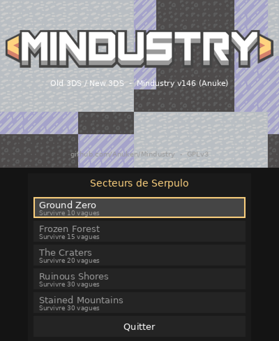
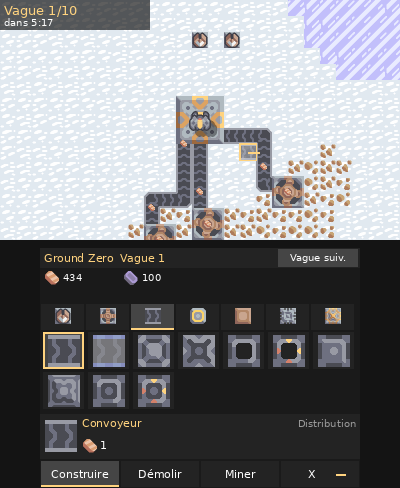
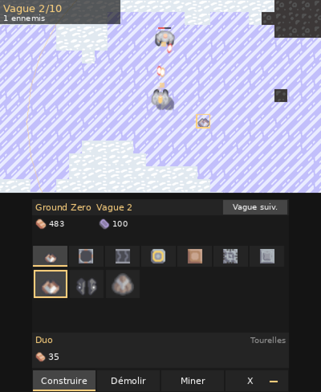

# Mindustry 3DS

Français | [English](README.en.md)

Portage natif de **Mindustry v146** (Anuke, GPLv3) pour **Nintendo 3DS**, conçu pour la **Old 3DS XL** (ARM11 268 MHz, mode application 64 Mo), compatible New 3DS.

Ce dépôt prend la suite de Forge3DS 1.4.6. Forge3DS était une réimplémentation « inspirée de » Mindustry, avec des valeurs recopiées à la main et un rendu logiciel. Mindustry 3DS est construit **à partir du projet open source original** : le dépôt [Anuken/Mindustry](https://github.com/Anuken/Mindustry) est inclus comme sous-module, épinglé sur le tag `v146`, et tout le contenu du jeu en est extrait au moment de la compilation.

| Menu | Base sur Ground Zero | Combat |
|---|---|---|
|  |  |  |

*Captures produites sur PC par `tests/screenshot.cpp`. Ce sont les vraies commandes de dessin du jeu, composées avec les sprites générés. Seule la police diffère de celle de la console.*

**Nouveautés 0.3** : eau, pompe mécanique, conduites, réservoir et générateur à vapeur selon les règles v146 ; sauvegardes au format 2, avec lecture des sauvegardes 0.2 ([docs/LIQUIDES_0.3.md](docs/LIQUIDES_0.3.md)).

**Nouveautés 0.2** : correction des artefacts visuels (sprites en miroir décalés par citro2d, halos de réduction, alignement au pixel, bordures d'atlas), icônes composites officielles, convoyeurs fidèles à `Conveyor`/`Autotiler` (raccords, animation, aperçu des virages), configuration des nœuds et ponts, états des machines et bilan électrique, panneaux solaires, pulvérisateur et mélangeurs, mesure FPS dans le menu pause. Détails et preuves : [docs/AMELIORATIONS_0.2.md](docs/AMELIORATIONS_0.2.md) ; inventaire Forge3DS : [docs/FORGE3DS_INVENTAIRE.md](docs/FORGE3DS_INVENTAIRE.md).

## Ce qui vient de Mindustry original

| Élément | Source upstream | Traitement |
|---|---|---|
| Valeurs des blocs, objets et unités | `content/Blocks.java`, `Items.java`, `UnitTypes.java` + valeurs par défaut des classes (`Drill.java`, `Turret.java`…) | `tools/javacontent.py` analyse le Java (initialiseurs `{{ }}`, constructeurs, héritage) et génère les tables C++ |
| Cartes des secteurs | `core/assets/maps/*.msav` (Ground Zero, Frozen Forest, The Craters, Ruinous Shores, Stained Mountains) | `tools/msav.py` lit le format de sauvegarde (portage de `SaveVersion.java`) : sol, minerais, murs, bâtiments, points d'apparition, règles et vagues |
| Vagues | règles JSON des cartes, `game/Waves.java` | `SpawnGroup.getSpawned()` porté à l'identique |
| Secteurs | `SectorPresets.java` | vague de capture, multiplicateur du premier compte à rebours |
| Sprites | `core/assets-raw/sprites` | réduits à 16 px par case (la moitié de l'original), contours ajoutés comme le packer de Mindustry, regroupés en atlas `tex3ds` |
| Textes | `core/assets/bundles/bundle_*.properties` | noms des blocs, objets et secteurs en français, anglais, allemand, espagnol, italien et japonais, selon la langue de la console |

La logique est un portage C++ des méthodes `updateTile()`, `acceptItem()` et `handleItem()` des classes Java. Exemples :

- **Convoyeur** : `Conveyor.ConveyorBuild.updateTile` (espacement 0,4, vitesse 0,03, fusion des courbes via `Autotiler`). Débit mesuré : 4,2 objets/s, la valeur affichée par Mindustry.
- **Foreuse** : `Drill.getDrillTime = drillTime + 50 × dureté`, échauffement 0,015, minerai dominant (`countOre`). Foreuse mécanique sur 4 cases de cuivre : 41 objets en 120 s.
- **Routeur, jonction, trieur, porte de débordement, pont** : rotation de `proximity`, tampons et `instantTransfer`.
- **Usines** (`GenericCrafter`), **générateur à combustion** (`ConsumeItemFlammable`), **réseau électrique** (`PowerGraph`, batteries, liaisons automatiques des nœuds).
- **Tourelles** (`ItemTurret`) : munitions par objet, `ammoMultiplier`, `limitRange()`, cadence, cône de tir, flak et artillerie.
- **Construction** : `ConstructBlock.construct` (accumulateurs, coût prélevé progressivement dans le noyau) et déconstruction avec remboursement de 50 %.
- **Unités** : Dagger, Flare, Alpha et Beta. Les deux armes de chaque unité tirent en alternance (`Weapon.alternate`). Les unités au sol suivent un champ de flux (`Pathfinder.costGround`) et les unités volantes appliquent `FlyingAI`. L'alpha mine selon `MinerComp` et transfère directement au noyau.

## Pourquoi ne pas exécuter le jeu Java ?

Il n'existe pas de JVM pour la 3DS, et le jeu de bureau dépasse de loin les 64 Mo disponibles en mode Old 3DS : son atlas de textures fait plusieurs pages de 4096², alors que le GPU PICA200 se limite à 1024². Le portage garde donc les données et les règles de Mindustry et remplace le moteur (Arc/Java) par du C++ natif :

- **simulation** sur le cœur applicatif ARM11, avec un *delta* plafonné comme `Time.delta` d'Arc ;
- **rendu GPU** avec citro2d (PICA200), au lieu du rendu logiciel de Forge3DS ;
- un seul atlas de 1024² en RGBA8 pour les 230 sprites utilisés.

## Ce qui n'est pas encore porté

Liquides autres que l'eau, jonctions et ponts liquides, usines d'unités et reconstructeurs, arbre de recherche et lancement entre secteurs, processeurs logiques (les processeurs de Ground Zero sont ignorés : le minuteur des vagues démarre directement), météo, brouillard, effets de statut, bonus d'eau des foreuses, Erekir. Les blocs non portés présents sur les cartes sont retirés au chargement (la liste figure dans `build/gen/assets_report.json`). Les sauvegardes utilisent un format propre au portage et ne sont pas compatibles avec les `.msav` de Mindustry.

## Commandes

| Touche | Action |
|---|---|
| Stick circulaire | piloter l'alpha (la caméra suit) |
| Croix directionnelle | déplacer le curseur de construction, avec répétition |
| A | poser le bloc ; maintenir A et bouger le curseur pour tracer une ligne de convoyeurs, orientée selon le tracé (aperçu des virages) |
| A sur un nœud, un pont ou un trieur | le configurer : A sur une cible pour lier/délier, A sur le nœud lui-même = liens automatiques ou tout délier, L/R = objet trié, B = terminer |
| B | démolir sous le curseur |
| X | tourner le bloc |
| Y | miner le minerai sous le curseur (appuyer à nouveau pour arrêter) |
| L / R | bloc précédent / suivant dans la catégorie |
| SELECT | catégorie suivante |
| START | pause : reprendre, sauvegarder et quitter, quitter ; affiche aussi les FPS et le temps CPU mesurés |
| Écran tactile | catégories, blocs, modes Construire / Démolir / Miner, « Vague suiv. » ; le curseur sur un bâtiment affiche sa fiche (état, raison, réseau) |

Les secteurs se débloquent dans l'ordre de la campagne : capturer un secteur, c'est survivre jusqu'à sa vague de capture, puis le suivant s'ouvre. Une sauvegarde automatique a lieu toutes les 2 minutes et à la fermeture, dans `SD:/3ds/mindustry-3ds/`.

## Installation

- **Homebrew Launcher** : copier `mindustry-3ds.3dsx` dans `SD:/3ds/`. Les données sont incluses dans le fichier.
- **CIA** : installer `mindustry-3ds.cia` avec FBI. Title ID `000400000F4D5300`, mode Old 3DS 64 Mo, pile de 256 Kio.

Les binaires sont produits par GitHub Actions : onglet *Actions* → *Build* → artefact `mindustry-3ds`.

## Compilation

```sh
git clone --recurse-submodules --shallow-submodules https://github.com/wabyu/mindustry-3ds-.git
cd mindustry-3ds-
# devkitPro (groupe 3ds-dev) + Python 3 avec Pillow
make            # génère build/gen, romfs/ depuis upstream/Mindustry, puis mindustry-3ds.3dsx
make test       # tests de simulation sur PC (AddressSanitizer + UBSan)
make scenes     # scènes de contrôle visuel composées avec le vrai atlas (build/scenes/*.png)
bash tools/install_cia_tools.sh && source .cia-tools/env.sh && make cia
```

Avec Docker : `docker run --rm -v $PWD:/src -w /src devkitpro/devkitarm make` (installer d'abord `python3-pil` dans le conteneur, comme dans `.github/workflows/build.yml`).

### Organisation

```
upstream/Mindustry   sous-module Anuken/Mindustry @ v146 (source unique des données)
tools/               javacontent.py, msav.py, build_assets.py, render_shots.py, CIA
source/              moteur C++ : world/sim/units (simulation), app (UI), main_3ds (citro2d)
tests/               host_test.cpp (règles), screenshot.cpp + gfx_host.cpp (captures)
cia/                 RSF, bannière, son
```

## État de validation

- 110 vérifications hôte passent (dont pompage, transfert, saturation, conservation, vapeur, lecture d'une sauvegarde 0.2) : débits, recettes, énergie (liens, plafond de 10, états, batteries), convoyeurs (4 directions, 28 cas de raccord, fusions, jonction, titane, embouteillage, rotation et amélioration sans perte), combat, construction, 5 cartes officielles et sauvegardes.
- Scènes de contrôle visuel : 0 sprite à 0°/90° posé entre deux pixels, 0 texel lu hors de son sprite, panoramiques lents et diagonaux identiques au pixel près. Ce sont des compositions hôte des appels citro2d, pas des captures de la console.
- Le `.3dsx` et le `.cia` compilent pour ARM11 (`-march=armv6k`). Le CIA passe une vérification statique : NCCH, exheader, mode 64 Mo, priorité et pile.
- La version 0.1 démarre et tourne de façon fluide sur une Old 3DS XL réelle (retour qualitatif). **La 0.3 reste à essayer sur console**, avec relevé des FPS du menu pause.

## Licence

GPLv3, comme Mindustry. Le code, les sprites, les cartes et les traductions de Mindustry appartiennent à Anuke et aux contributeurs de Mindustry. Les outils CIA reprennent ceux de Forge3DS. Projet non officiel, sans lien avec Anuke.
